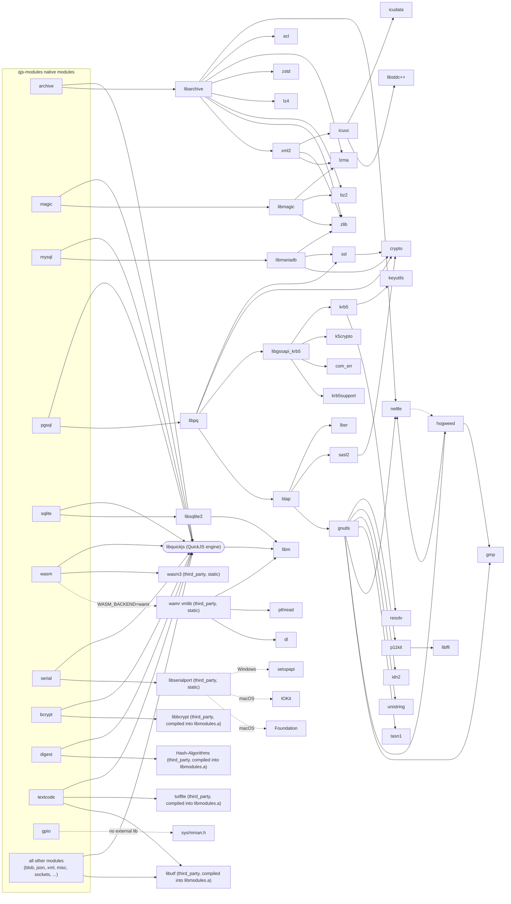

# Third-party dependencies of the native modules

Libraries that `quickjs-*.c` / `quickjs-*.h` need when every module is enabled
(`MODULE_ARCHIVE`, `MODULE_MAGIC`, `MODULE_MYSQL`, `MODULE_PGSQL`, `MODULE_SQLITE`,
`MODULE_BCRYPT`, `MODULE_DIGEST`, `MODULE_SERIAL`, `MODULE_WASM` ON; `MODULE_GPIO` is
Raspberry Pi only and OFF by default, listed for completeness).

Sources: `CMakeLists.txt` section 7, `cmake/deps/*.cmake`, `cmake/wamr/`, the `#include`
lines of `quickjs-*.[ch]`, and `ldd` / `readelf -d` of the `x86_64-linux-gnu` build
(Ubuntu 24.04 system libraries). Versions are those on the build host.

Legend: **direct** = the module's own `.c` includes the header and links the library;
**indirect** = pulled in by a direct library (shared: its `DT_NEEDED`; static: listed
explicitly on the link line, because an archive carries no dependency information).

## 1. Dependency graph

`libmodules.a` (`add_library(modules STATIC ...)`) holds `tutf8e`, `libutf`, `libbcrypt`
and `Hash-Algorithms`, so these four reach every binary that links it, not only the
module that includes them (`libutf` is also included by `src/char-utils.c`).

## 2. Per module (direct and indirect)

| Module | Direct | Indirect (shared build) | Indirect (static build) |
|---|---|---|---|
| all modules | libquickjs | libm (libc, libm) | libquickjs, libm |
| archive | libarchive | nettle, acl, lzma, zstd, lz4, bz2, zlib, xml2; then icuuc, icudata, libstdc++, libgcc_s (via xml2) | libarchive + each codec archive: bz2, libb2, lzma, lz4, lzo2, zlib, zstd (built from source when absent) |
| magic | libmagic | lzma, bz2, zlib | libmagic only (built with all codecs off) |
| mysql | libmariadb | zlib, ssl, crypto | same |
| pgsql | libpq | ssl, crypto, gssapi_krb5, ldap; then krb5, k5crypto, com_err, krb5support, keyutils, resolv, lber, sasl2, gnutls, p11-kit, idn2, unistring, tasn1, nettle, hogweed, gmp, libffi | same |
| sqlite | libsqlite3 | libm | libsqlite3 (built from the 3.50.4 amalgamation when absent) |
| wasm | wasm3 (default) or wamr | none (libm, libc) | wasm3 archive; wamr: libm, pthread, dl |
| serial | libserialport | none on Linux | libserialport archive; Windows adds setupapi |
| bcrypt | libbcrypt | none | compiled into libmodules.a |
| digest | Hash-Algorithms (md5, sha1, sha224, sha256, sha512) | none | compiled into libmodules.a |
| textcode | tutf8e, libutf | none | compiled into libmodules.a |
| gpio | none (sys/mman.h) | none | none |
| sockets | none; Windows: mswsock, ws2_32 | none | none |

Modules with no third-party library at all: arraybuffer-sink, bjson, blob, child-process,
deep, directory, inspect, json, lexer, list, location, misc, mmap, path, pointer,
predicate, queue, repeater, syscallerror, tree-walker, virtual, xml, yaml.

## 3. Libraries and where they come from

| Library | System probe | Built from source when | Submodule / URL | Switch |
|---|---|---|---|---|
| QuickJS | `FindQuickJS.cmake` | `BUILD_QUICKJS` | engine checkout | `BUILD_QUICKJS=AUTO` |
| libarchive | `FindLibArchive` | `BUILD_LIBARCHIVE=ON` | `third_party/libarchive` (v3.7.5) | `MODULE_ARCHIVE` |
| bz2, libb2, lzma, lz4, lzo2, zlib, zstd | `cmake/deps/Find*.cmake` | codec ON and not found | downloaded by `Build*.cmake` | `LIBARCHIVE_{GZIP,BZIP2,LZ4,LZMA,ZSTD,LZO}` |
| libmagic | `find_libmagic()` | no usable libmagic and magic.h | `file-5.46` tarball (astron.com) | `MODULE_MAGIC` |
| libmariadb | `pkg_search_module(mariadb libmariadb mysqlclient)` | never | system only | `MODULE_MYSQL` |
| libpq | `FindPgSQL.cmake` | never | system only | `MODULE_PGSQL` |
| libsqlite3 | `pkg_check_modules(sqlite3)` | no usable sqlite3 and sqlite3.h | sqlite-autoconf-3500400 (sqlite.org) | `MODULE_SQLITE` |
| wasm3 | none | always | `third_party/wasm3` | `MODULE_WASM`, `WASM_BACKEND=wasm3` |
| WAMR | none | always | `third_party/wamr` (`cmake/wamr`) | `WASM_BACKEND=wamr` |
| libserialport | none | `BUILD_LIBSERIALPORT=ON` (default) | `third_party/libserialport` (rsenn fork) | `MODULE_SERIAL` |
| libbcrypt | none | always | `third_party/libbcrypt` | `MODULE_BCRYPT` |
| Hash-Algorithms | none | always | `third_party/Hash-Algorithms` | `MODULE_DIGEST` |
| tutf8e, libutf | none | always | `third_party/tutf8e`, `third_party/libutf` | always on |
| pigpio | `Findpigpio.cmake` | never | `third_party/pigpio` | unused: nothing includes pigpio.h |

## 4. Notes

- libarchive is configured with `ENABLE_OPENSSL`, `ENABLE_LIBXML2`, `ENABLE_EXPAT`,
  `ENABLE_ICONV`, `ENABLE_ACL` on by default, so a source build also picks up whatever of
  openssl, libxml2, expat, iconv, acl it finds on the host. The system libarchive on the
  build host was linked against nettle and libxml2 instead (see the table above).
- Under musl or WASI the source build turns OpenSSL, expat, libxml2, iconv and pcre off,
  and WASI also turns off ACL, xattr, nettle and mbedtls.
- `mysql.so` and `pgsql.so` link the system client libraries dynamically, so they are
  the only modules whose runtime closure is large (pgsql: 25 shared objects).
- The static modules (`BUILD_STATIC=ON`) get the library list from the generated
  `quickjs-<name>.module.cmake` sidecar (`<name>_LIBRARIES`), not from `DT_NEEDED`.
- Regenerate the shared closure with:
  `ldd build/<triplet>/<module>.so`, and the direct part with `readelf -d <lib> | grep NEEDED`.
